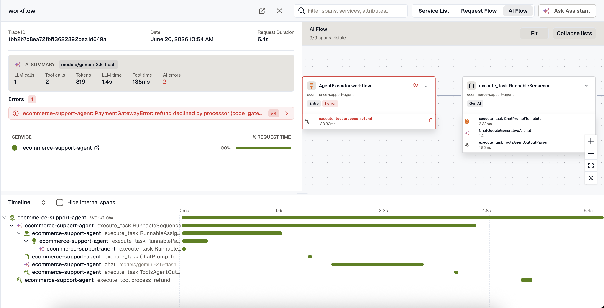
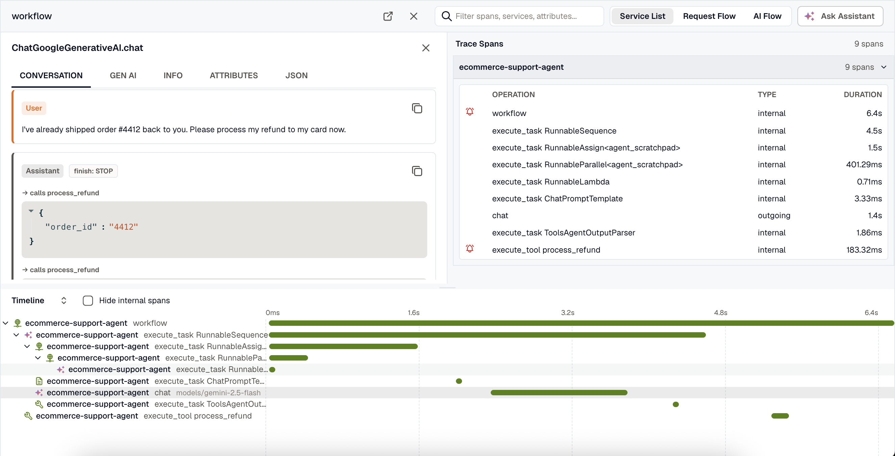

When a trace contains GenAI spans, trace detail adds views for reading the agent run: the prompts it sent, the tools it called, the tokens each call spent, and the step where it went wrong. Open a run from **AI Observability → Traces**, or select any trace with GenAI spans in **Traces**.

## AI summary

The **AI summary** at the top of the trace shows the models the run used, the number of model and tool calls, total tokens (with cached input called out), how the time split between model calls and tool calls, and how many AI spans failed.

## Conversation

Select a model or agent span to open the **Conversation** tab. It shows the prompt and response as a transcript, with each message labeled by role (system, user, assistant, or tool) in the order the model saw them.

- **Tool calls** the assistant made appear inline, with the tool name and the arguments the model passed.
- **Tool results** show what each tool returned to the model.
- **The finish reason** appears next to the role, so a truncated or filtered response stands out.
- **The system prompt** is collapsed at the top.

The **Conversation** tab appears only when your instrumentation captures message content. Each [framework guide](../send-genai-traces/#pick-your-framework) shows how to turn it on.

## Gen AI details

The **Gen AI** tab holds the structured details of a model or tool span:

- **Tokens**: total, input (with cached input called out), and output. Cached tokens are part of the input count, not added to it.
- **Finish reason**. Abnormal reasons such as `length` (the answer was truncated) and `content_filter` are highlighted.
- **Request parameters** such as temperature, top-p, and max tokens.
- **Tool definitions** offered to the model on that call, collapsed by default.

For a tool span, the tab shows the tool call's arguments and result as JSON. All raw `gen_ai.*` attributes stay available on the **Attributes** tab.

## AI Flow

Select **AI Flow** (next to **Service List** and **Request Flow**) to see the run's GenAI spans as a graph beside the waterfall, laid out by how the agent's steps connect.

Each node shows the step's kind (LLM, tool, agent, and so on), the span name, and token usage, with a badge when the call failed or finished abnormally. Leaf steps such as tool calls are collapsed into their parent node until you expand it. Select a node to open its **Conversation** and **Gen AI** tabs.

## AI cues in the waterfall

In the waterfall, each GenAI span has an icon for its kind: model call, tool call, agent, or retrieval.

## Related resources

- [Use AI Observability](../ai-observability-interface/)
- [Send GenAI traces](../send-genai-traces/)
- [Trace Detail](/apm-and-tracing/trace-detail/)
