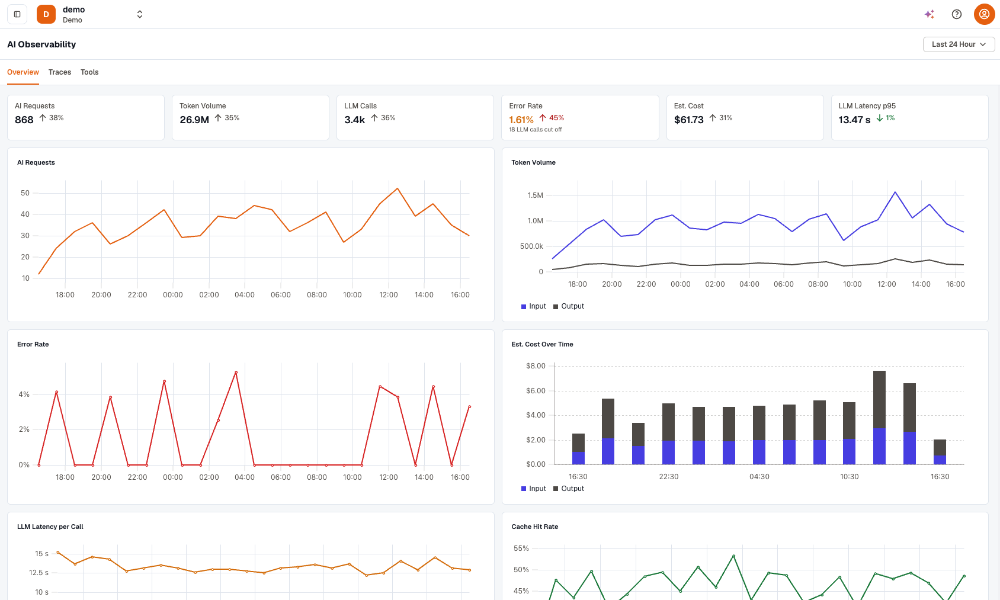

AI Observability gives you end-to-end visibility into the LLM applications and agents running in your workspace. A single request to an agent can fan out into several model calls, tool calls, and retries across different providers, and each step adds latency, token cost, and another point of failure. AI Observability traces every request through those steps, so you can track usage and spend by model, provider, and agent, find the tool calls that fail or slow a run down, and open any run to read the prompts, responses, and tool calls behind it.

It's built on the OpenTelemetry GenAI semantic conventions, so any app or agent that exports GenAI traces shows up here, whichever framework or model provider it uses. You don't need a proprietary SDK.

Open it from **AI Observability** in the sidebar:

- **Overview** tracks requests, token volume, estimated cost, error rate, and latency over time, with breakdowns by model, provider, and agent.
- **Traces** lists each agent run with its models, steps, tokens, and cost. Select a run to open its trace.
- **Tools** reports how often each tool is called, how often it fails, and how long it takes, for both local functions and MCP tools.

## What KloudMate does with your traces

Frameworks describe the same thing in different ways. OpenInference reports input tokens as `llm.token_count.prompt`, while the Vercel AI SDK uses `ai.usage.inputTokens`. When your spans arrive, KloudMate maps them onto the [OpenTelemetry GenAI semantic conventions](https://github.com/open-telemetry/semantic-conventions-genai/blob/main/docs/gen-ai/README.md), so a Claude Code turn and a LangGraph run are counted the same way:

- **Attribute names** from each [supported framework](./send-genai-traces/#pick-your-framework), and older GenAI names such as `gen_ai.system`, are mapped to the current names.
- **Provider names and finish reasons** are made consistent. For example, `end_turn` becomes `stop` and `max_tokens` becomes `length`.
- **Missing values are filled in** from related spans. A conversation ID set on a parent span is copied to the GenAI spans under it, and an agent span without its own input and output gets them from its first and last model calls.
- **Internal framework steps aren't counted twice.** For example, an MCP tool call recorded by both the client and the server counts once.
- **Each model call gets an estimated cost.** See [How cost is estimated](./ai-observability-interface/#how-cost-is-estimated).

Renamed attributes keep their values, and values that already follow the conventions aren't changed.

## Key concepts

| Term | Meaning |
| --- | --- |
| Run | One request your AI app handled from start to finish. The **AI Requests** count and the rows on the **Traces** tab are runs. See [How runs are built](./ai-observability-interface/#how-runs-are-built). |
| Turn | A run that starts with an agent span (`invoke_agent`), named after the agent, for example **Claude Code Turn**. |
| LLM call | A single request to a model. One run can make many LLM calls. |
| Tool call | A span whose operation is `execute_tool`, labeled **Local**, **MCP**, **Extension**, or **Datastore**. |
| Conversation | The traces that share a `gen_ai.conversation.id`. |
| Est. Cost | The estimated price of the model calls in USD. See [How cost is estimated](./ai-observability-interface/#how-cost-is-estimated). |

## Get started

1. Create an API key in **Settings → Ingest Keys**.
2. Instrument your app or agent and point its exporter at KloudMate. [Send GenAI traces](./send-genai-traces/) links to a setup guide for each supported framework.
3. Run your app, then open **AI Observability**.

## Related resources

- [Use AI Observability](./ai-observability-interface/)
- [Agent Traces](./agent-traces/)
- [Send GenAI traces](./send-genai-traces/)
