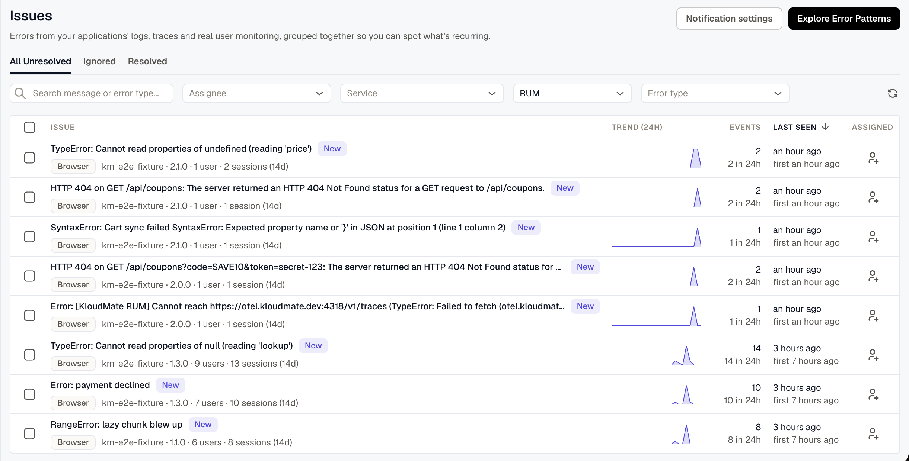
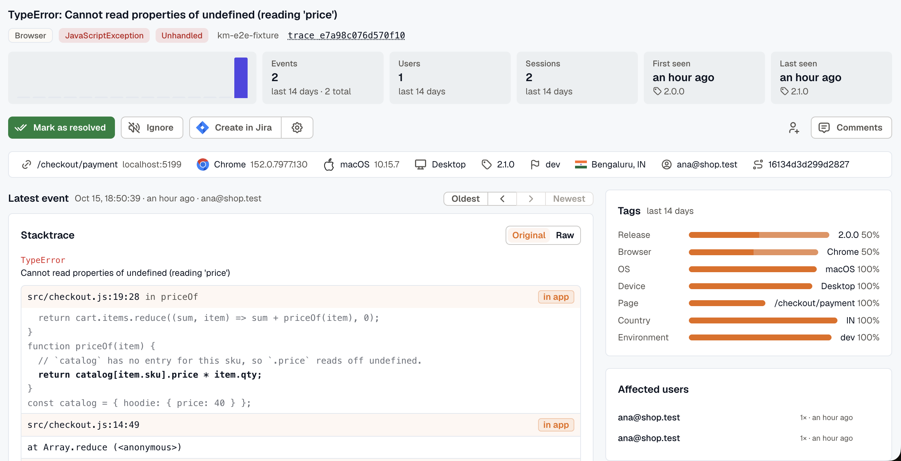

KloudMate groups the errors in your logs, traces, and real user monitoring (RUM) into issues. Each issue is one kind of error, and every time that error happens again, it adds an event to the issue. Use the Issues list to see what's failing right now, then open an issue to find out who it hit, what led up to it, and where in your code it was thrown.

To open the list, click **Issues** in the left navigation menu.

## Find the issues that need attention



The figures in the list cover different time ranges. The event count is the total since the issue was first seen, while the trend and the count under it cover the last 24 hours. For example, an issue with 5,000 events and none in the last 24 hours has probably stopped happening. Sort by **Last seen** to find what's failing now.

For a RUM issue, the users and sessions cover the last 14 days. The release shown is the latest event's release, which tells you whether the error still happens in your most recent deploy.

An issue is marked **New** for 24 hours after it was first seen.

Search matches both the error message and the error type. For example, searching for `TypeError` finds every issue of that type, whatever its message.

To resolve or ignore several issues at once, select them in the list and choose the action. A selection covers only the current page, and changing the tab, a filter, the sort order, or the page clears it.

## Investigate an issue



Log, trace, and RUM issues all show how often the error happens and its stack trace. The rest of a RUM issue comes from what the RUM SDKs report with each error: the user, the session, and what happened before it. Users and sessions, **Before the error**, **Tags**, and **Affected users** appear on RUM issues only.

For a structured log, the title is the readable message from the log record.

### What the numbers count

The figures at the top of an issue cover the last 14 days. The exceptions are the total event count and **First seen**, which go back to the first event. The trend counts events per UTC day, so a day's bar may not line up with your local calendar day.

**Users** counts people, not sessions. Each signed-in user counts once, and so does each browser whose visitor never signed in. Anonymous browsers are counted for events from browser SDK 2.7.0 and later. For events from older versions, only users identified with `setUser()` are counted.

On a RUM issue, **First seen** and **Last seen** also show the release of the first and latest events. The first event's release is shown only when that event happened in the last 14 days.

### Handled and unhandled errors

A RUM issue is marked **Handled** or **Unhandled** for the event you're viewing:

- **Handled** means your app caught the error and reported it, with `recordException()` or `console.error()`.
- **Unhandled** means nothing in your app caught it, such as an uncaught exception or an unhandled promise rejection.

The flag needs browser SDK 2.8.0 or later. Events from older versions aren't marked either way.

### One event at a time

The context, stack trace, and **Before the error** on a RUM issue all describe a single event. The page opens on the latest event and moves to newer ones as they arrive. Use **Oldest**, **Newest**, and the arrows to look at any other event from the last 14 days. After you step back to an older event, the page stays on that event.

A log or trace issue shows its latest event from the last 6 days.

### Read the stack trace

For a browser issue, each frame is mapped through the [source maps](../rum/source-maps/) you uploaded, so you see your original file, line, and code instead of the minified bundle. Switch to **Raw** to see the stack as the browser reported it.

A frame that couldn't be mapped carries a badge with the reason, such as **no source map** or **ambiguous release**. [Troubleshoot unmapped frames](../rum/source-maps/#troubleshoot-unmapped-frames) explains each badge and how to fix it.

For a log or trace issue, the stack is shown as it was reported.

### See what led up to the error

**Before the error** lists what happened in the session during the 60 seconds before a RUM error: page loads and route changes, clicks, requests with their status and duration, console warnings and errors, custom events sent with `addEvent()`, long tasks, and earlier errors. For example, a `POST /api/cart` that returned `500` two seconds before a `TypeError` usually explains the error.

The trail needs browser SDK 2.7.0 or later. The SDK keeps personal data out of it:

- URLs are recorded without their query string or fragment.
- A click records the label of the button or link, such as `click "Pay now"`, never the content of a form field.
- A click inside an element with the `km-mask` class, or with the session recorder's block or ignore class (`km-block` and `km-ignore` by default), records no text. The same applies to a control that contains one of these elements.

To keep click labels out of the trail, set `captureClickText` to `false`. To turn the trail off, set `breadcrumbs.enabled` to `false`:

```javascript
KloudMateRum.init({
  endpoint: 'https://otel.kloudmate.com:4318',
  rumAccessToken: 'YOUR_PUBLIC_API_KEY',
  applicationName: 'my-app',
  breadcrumbs: { captureClickText: false },
});
```

### Find out who was affected

**Tags** breaks down a RUM issue's events from the last 14 days by release, browser, OS, device, page, country, and environment. A value near 100% narrows down the cause. For example, `Safari 100%` under **Browser** points at a Safari-only bug, and a single release points at that deploy.

**Affected users** lists the 10 sessions the issue hit most recently. A visitor who wasn't signed in is listed as **Anonymous** with the start of the browser's visitor ID, so you can tell two anonymous visitors apart. If the session was recorded, its replay starts 5 seconds before the error. See [Record sessions for replay](../rum/instrumentation-guide/web/#record-sessions-for-replay) to turn recording on.

The event list holds up to 100 of the latest events: from the last 14 days for a RUM issue, or from the last 6 days for a log or trace issue.

## Resolve, ignore, or assign an issue

- **Mark as resolved** moves the issue to **Resolved**. If the error happens again, the issue reopens.
- **Ignore** stops notifications for the issue and moves it to **Ignored**, out of the unresolved list. Click it again to stop ignoring the issue.
- **Ask Assistant** opens the [KloudMate Assistant](../kloudmate-assistant/) with a prompt about the issue already written. Nothing is sent until you send it.
- **Create in Jira** needs a [Jira integration](../platform/settings/notification-channels/#jira).
- Team members are notified when you assign an issue to them. Everyone who comments on an issue is notified of later comments, and you can mention other users in a comment.

## How long issues are kept

An issue is deleted after 15 days without an event, whether it's unresolved, resolved, or ignored. Its comments and assignments are deleted with it.

If the error happens again after that, it starts a new issue. The new issue is unresolved, marked **New**, and triggers a new-issue notification, even if you had ignored the old one.

## Notification preferences

Click **Notification settings** on the Issues list to choose when you're notified:

- **New Issues**: issues detected for the first time.
- **New and Regression Issues**: issues detected for the first time, as well as issues that had previously occurred and have reappeared.

To send these notifications to specific channels for specific services, see [Notification routing](./notification-routing/).

Click **Explore Error Patterns** to find recurring error patterns across your services.

## User permissions

- **Owner and Developer**: resolve and ignore issues, one at a time or in bulk, assign issues, create Jira tickets, and comment.
- **Viewer**: assign issues and comment, but not resolve or ignore them.

## Related Resources

- [Notification routing](./notification-routing/)
- [Source maps](../rum/source-maps/)
- [Session detail](../rum/session-detail/)
- [Browser SDK reference](../rum/instrumentation-guide/sdk-reference/)
- [Routing Rules](../alerts/routing-rules/)
- [Notification Channels](../platform/settings/notification-channels/)
