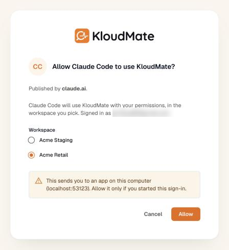

import { Tabs, TabItem, Steps, LinkCard, CardGrid } from '@astrojs/starlight/components';

The KloudMate MCP server lets your AI tools and agents read observability data from your workspace. Connect a client such as Claude, Cursor, or VS Code, and you can ask about errors, latency, traces, and firing alerts in plain language without opening the KloudMate UI.

This is the reverse of the [MCP integrations](../settings/#mcp-integrations) you connect to the Assistant. There, KloudMate calls out to other tools. Here, your agent calls in to KloudMate. The connection uses the [Model Context Protocol](https://modelcontextprotocol.io/), an open standard for giving language models access to tools and data.

## Connection details

| Setting | Value |
|---|---|
| **Endpoint** | `https://api.kloudmate.com/mcp` |
| **Transport** | Streamable HTTP |
| **Authentication** | OAuth sign-in, or a Personal API Key with an `x-workspace-id` header |

**Sign in with OAuth** when your client supports it. The client needs only the endpoint URL, and you sign in to KloudMate in your browser and pick a workspace. Claude, ChatGPT, Cursor, VS Code, and MCP Inspector all support OAuth for remote MCP servers.

**Use a Personal API Key** for scripts, and for clients that can't sign in with OAuth. You send the key and a workspace ID as request headers.

## Before you start

You'll need:

- **A workspace whose plan includes the MCP server.** If the plan doesn't include it, you can't allow the connection on the consent page, and requests made with an API key are refused.
- **An MCP client that supports remote servers over Streamable HTTP.** The steps below cover Claude Code, Cursor, VS Code, and Claude on the web and desktop.

## Connect with OAuth sign-in

Add `https://api.kloudmate.com/mcp` to your client as a remote MCP server. You don't need a key or any headers. The first time the client connects, it opens KloudMate in your browser:

<Steps>

1. Sign in to KloudMate, if you aren't signed in already.

2. On the consent page, pick the workspace the app can read.

3. Click **Allow**. Your browser goes back to the app, and the app is connected.

</Steps>



Click **Allow** only if you started the sign-in yourself. A sign-in expires if you don't finish it within 10 minutes. If that happens, connect again from the app.

The connection reads only the workspace you picked, so you don't send a workspace ID with each request. To read a different workspace, sign out of the server in your client, sign in again, and pick the other workspace.

<Tabs>
<TabItem label="Claude Code">

Add the server from your terminal:

```bash
claude mcp add --transport http kloudmate https://api.kloudmate.com/mcp
```

By default, the server is available in the current project only. Add `--scope user` before the server name to make it available in all your projects:

```bash
claude mcp add --transport http --scope user kloudmate https://api.kloudmate.com/mcp
```

Start Claude Code, run `/mcp`, select `kloudmate`, and authenticate. Claude Code opens KloudMate in your browser. You can also sign in from your terminal with `claude mcp login kloudmate`, and sign out with `claude mcp logout kloudmate`.

</TabItem>
<TabItem label="Cursor">

Create or edit `~/.cursor/mcp.json` (all projects) or `.cursor/mcp.json` (this project only), and add the server:

```json
{
  "mcpServers": {
    "kloudmate": {
      "url": "https://api.kloudmate.com/mcp"
    }
  }
}
```

Cursor starts the sign-in when it connects to the server. If `kloudmate` shows that it needs authentication, click **Connect** on it.

</TabItem>
<TabItem label="VS Code">

Create `.vscode/mcp.json` in your workspace:

```json
{
  "servers": {
    "kloudmate": {
      "type": "http",
      "url": "https://api.kloudmate.com/mcp"
    }
  }
}
```

Start the server from the **Start** action above the entry, or run **MCP: List Servers** from the Command Palette. When VS Code asks whether the server can authenticate, click **Allow**, then sign in to KloudMate in your browser. The tools become available to agent mode in Copilot Chat.

</TabItem>
<TabItem label="Claude">

These steps work on claude.ai and in Claude Desktop.

<Steps>

1. Open **Customize > Connectors**.

2. Click **+ Add**, then **Add custom connector**.

3. Enter `KloudMate` as the name and `https://api.kloudmate.com/mcp` as the URL, then click **Continue**.

4. Keep the detected authentication settings and click **Continue**.

5. Under **Authentication**, choose **Sign in now**, then click **Add**. Claude opens KloudMate so you can sign in.

</Steps>

To use the connector in a chat, click **+**, then **Connectors**, and turn on KloudMate.

On a Team or Enterprise plan, an Owner adds the connector under **Organization settings > Connectors**. Each member then clicks **Connect** on it under **Customize > Connectors** and signs in to KloudMate with their own account.

</TabItem>
<TabItem label="ChatGPT">

Add a custom connector in ChatGPT with `https://api.kloudmate.com/mcp` as its URL and **OAuth** as its authentication. ChatGPT opens KloudMate so you can sign in.

If ChatGPT asks how to register the client, either method works:

- **Client ID Metadata Document (CIMD)**: ChatGPT identifies itself with its published metadata document.
- **Dynamic Client Registration (DCR)**: ChatGPT registers itself with KloudMate the first time it connects.

</TabItem>
</Tabs>

For any other client that supports OAuth for remote MCP servers, such as MCP Inspector, enter the endpoint URL and sign in the same way.

### Client registration

Most clients register themselves, so you don't need this section to connect one. It's for you if you're building a client, or if your client asks which registration method or authentication to use.

KloudMate supports two ways for a client to register:

| Method | How the client identifies itself | Token endpoint authentication |
|---|---|---|
| **Client ID Metadata Document (CIMD)** | Its `client_id` is an `https` URL to its own metadata document, which KloudMate fetches and caches for a day. | `none`, or `private_key_jwt` when the document names its signing keys: an inline `jwks`, or an `https` `jwks_uri` on the document's own host. |
| **Dynamic Client Registration (DCR)** | It registers at `https://api.kloudmate.com/oauth/register` and gets a `client_id`. | `none`, `client_secret_basic`, or `client_secret_post`. |

Every client uses the authorization code flow with PKCE (`S256`). The scopes are `mcp`, and `offline_access` for a refresh token.

A client that authenticates with `private_key_jwt` sends a client assertion (RFC 7523) to the token endpoint. Sign it with `RS256` or `ES256`, set `iss` and `sub` to the `client_id`, set `aud` to `https://api.kloudmate.com/oauth/token`, and keep it to 5 minutes or less. Each assertion works once.

A client discovers all of this from two documents:

- `https://api.kloudmate.com/.well-known/oauth-protected-resource/mcp`: the MCP server's protected resource metadata (RFC 9728).
- `https://api.kloudmate.com/.well-known/oauth-authorization-server`: the authorization server metadata (RFC 8414).

## Connect with an API key

Use a Personal API Key for scripts, and for clients that can't sign in with OAuth. Send the key as a bearer token, and the workspace ID in an `x-workspace-id` header:

| Header | Value |
|---|---|
| `Authorization` | `Bearer YOUR_API_KEY` |
| `x-workspace-id` | `YOUR_WORKSPACE_ID` |

To create a key, open **API keys** from the account menu (top-right) and click **Create Key**. Copy the key when it's shown, because it's shown only once. Any signed-in user can create one, and you don't need the **Developer** role. See [API Keys](../../platform/settings/api-keys/#personal-api-keys) for details.

A personal key works for every workspace you belong to in your organization, so the `x-workspace-id` header picks the workspace each request reads. Find the workspace ID in the workspace's URL in the KloudMate app.

:::caution
Your API key carries your KloudMate access. Treat it like a password: don't paste it into shared files or commit it to version control. The configs below keep it in an environment variable or a prompted secret instead. If a key leaks, delete it from the **Personal API Keys** screen in your account menu.
:::

<Tabs>
<TabItem label="Claude Code">

```bash
claude mcp add --transport http kloudmate https://api.kloudmate.com/mcp \
  --header "Authorization: Bearer YOUR_API_KEY" \
  --header "x-workspace-id: YOUR_WORKSPACE_ID"
```

Add `--scope user` before the server name to make the server available in all your projects. Run `/mcp` inside Claude Code to confirm that `kloudmate` is connected.

</TabItem>
<TabItem label="Cursor">

```json
{
  "mcpServers": {
    "kloudmate": {
      "url": "https://api.kloudmate.com/mcp",
      "headers": {
        "Authorization": "Bearer ${env:KLOUDMATE_API_KEY}",
        "x-workspace-id": "YOUR_WORKSPACE_ID"
      }
    }
  }
}
```

The `${env:KLOUDMATE_API_KEY}` reference reads the key from your environment, so it never lands in the file. Set `KLOUDMATE_API_KEY` in your shell profile before you start Cursor.

</TabItem>
<TabItem label="VS Code">

The `inputs` block prompts you for the key the first time the server starts and stores it securely, so the key stays out of the file:

```json
{
  "inputs": [
    {
      "type": "promptString",
      "id": "kloudmate-api-key",
      "description": "KloudMate Personal API Key",
      "password": true
    }
  ],
  "servers": {
    "kloudmate": {
      "type": "http",
      "url": "https://api.kloudmate.com/mcp",
      "headers": {
        "Authorization": "Bearer ${input:kloudmate-api-key}",
        "x-workspace-id": "YOUR_WORKSPACE_ID"
      }
    }
  }
}
```

</TabItem>
</Tabs>

## Verify the connection

After you connect, ask a question that needs live data:

> Which alerts are firing in KloudMate right now?

If the connection works, the agent calls a KloudMate tool and answers from your workspace.

- **The app asks you to sign in again.** An app renews its access every hour on its own. If it goes 30 days without renewing, or you lose access to the workspace, the renewal fails and you need to sign in again.
- **Requests fail with an access error.** You no longer have access to the workspace the connection reads. KloudMate checks your access on every request.
- **An API key fails to authenticate.** The key is wrong or deleted, or the `Authorization` header is missing the `Bearer ` prefix.
- **An API key request is refused for a missing workspace.** Add the `x-workspace-id` header.

## Available tools

Every tool is read-only. The tools read your telemetry and never create, edit, or delete anything in KloudMate.

A time window is a duration that ends now, such as `30m`, `6h`, or `2d`, or two ISO 8601 times joined by `/`. Each tool has its own default window. When a question mentions a service, host, or other resource, the tool looks it up first. If the name matches several resources, or none, the tool returns the candidates instead of reading data.

**Logs, traces, and metrics**

- `search_logs`: logs filtered by any field, with counts by severity over time, common patterns, and the fields that vary. It can also return the log lines, and it searches Kubernetes events too.
- `search_traces`: spans filtered by any field, with counts, errors, and p50, p95, and p99 latency, plus error patterns and the slowest spans. It can also return traces or a single trace.
- `aggregate_telemetry`: counts and percentiles over logs or traces, grouped by any field, such as errors by service or p95 duration by endpoint.
- `query_metrics`: find metrics, list a label's values, read series against the previous window, or run PromQL. For a single resource, it reads every metric the resource has, such as a pod's restarts and limits or a host's load.
- `explore_fields`: the fields that logs, traces, or metrics carry, with their common values, or the values of one field with counts.

**Alerts, errors, and changes**

- `check_alerts`: alert groups and their alerts, with what fired and when, the rule and its condition, the latest values, silences, and maintenance windows. It can also read a single alert rule, or the rules firing for a resource. Without a target, it lists the open alert groups.
- `search_error_patterns`: error patterns from logs, traces, and RUM, with the service, severity, first and last seen times, how often they occurred compared with the previous window, state, assignees, and comments.
- `check_changes`: what changed in a window. It compares the values of the fields you choose, such as a version, an image, or a host, against the previous window, and lists Kubernetes Normal events.
- `find_entities`: the service, host, workload, or other resource a name refers to, with its kind, when it last reported, and its firing alerts. It can also show what the resource depends on and what depends on it.

**Kubernetes**

- `check_kubernetes`: Kubernetes objects as the Kubernetes pages list them, problems first. That covers pods with their status, restarts, and usage against limits; workloads against their desired state; and jobs, persistent volume claims, and nodes.
- `inspect_kubernetes`: one workload, pod, or node in depth, with its state against desired, its pods, a deployment's ReplicaSets, and the events on it. Use it to find out why a workload is down or a pod keeps restarting.
- `search_kubernetes_events`: Kubernetes events by reason and object, warnings first, such as back-offs, failed scheduling, image pulls, probe failures, OOM kills, and rollouts.

**Reliability and user impact**

- `check_slos`: each SLO's objective, compliance, remaining error budget, and burn-rate alerts over the SLO's own window.
- `check_synthetics`: whether each synthetic monitor is up or down, with its last run, success rate, outages, time to recover, and SSL expiry.
- `check_incidents`: open incidents; one incident's timeline, notes, responders, and tickets; status page posts; and who is on call now.
- `check_user_impact`: real user monitoring insights such as error spikes and slow pages, LCP and app cold start, error and crash rates, and a comparison between releases.

**Dashboards**

- `read_dashboards`: find dashboards, list a dashboard's panels, or read a panel's current values against its thresholds.

## Example prompts

After you connect, ask in plain language. The agent picks the tools and fills in the queries:

- *"What are the top errors in the `checkout` service over the last hour?"*
- *"Show me the slowest traces for `api-gateway` in the past 15 minutes."*
- *"Which alerts are firing right now, and what changed in the half hour before they fired?"*
- *"Why does the `payments` pod keep restarting?"*
- *"Pull the logs for trace `4bf92f3577b34da6` and summarize where it failed."*

## Build custom workflows

Your agent can combine these tools with anything else it can reach, such as your codebase, a runbook, or your deployment history. That lets you turn an investigation that spans several KloudMate screens into a repeatable prompt.

For example, a triage prompt might read the open alert groups, check what changed before they fired, pull the related traces and logs, and return a summary with a probable cause. Save it as a reusable command or prompt in your tool, and run it at the start of each on-call investigation.

## Security and scope

- **Read-only.** The tools can't change anything in your workspace.
- **Your permissions, one workspace.** Every connection acts with your own permissions. An OAuth connection reads only the workspace you picked when you signed in. An API key connection reads the workspace in its `x-workspace-id` header. KloudMate checks your access on every request, so a connection can't read a workspace you can't.
- **Disconnect from the app.** To disconnect an app that signed in with OAuth, remove the KloudMate server or connector in that app. KloudMate doesn't list the apps you've connected.
- **Keep API keys secret.** Prefer the environment variable or prompted secret options above over pasting a key into a file, and add any config file that contains a key to `.gitignore`. If a key is exposed or no longer used, delete it from the **Personal API Keys** screen. Any client using it stops working immediately.

## Related

<CardGrid>
  <LinkCard title="API Keys" description="Create a Personal API Key for scripts and for clients that can't sign in with OAuth." href="../../platform/settings/api-keys/#personal-api-keys" />
  <LinkCard title="MCP Integrations" description="Connect external MCP servers and tools into the KloudMate Assistant." href="../settings/#mcp-integrations" />
  <LinkCard title="Investigations" description="Run AI-assisted root cause analysis inside KloudMate." href="../investigations/" />
  <LinkCard title="KloudMate Assistant" description="The in-app AI assistant for monitoring, dashboards, and RCA." href="../" />
</CardGrid>
