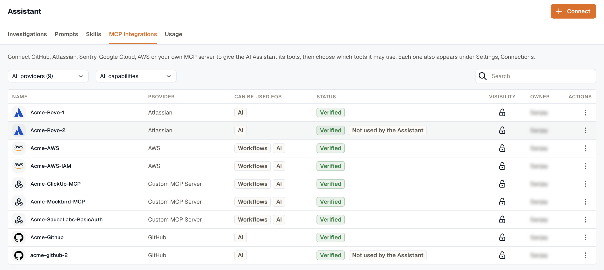
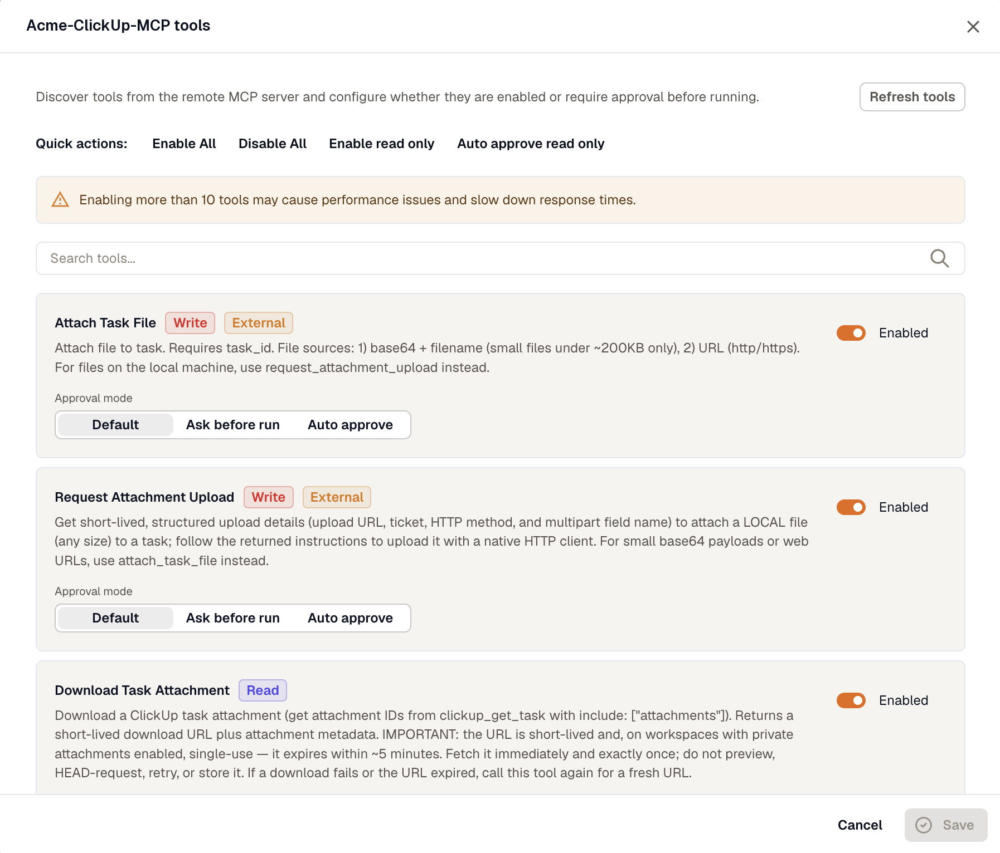

Prompts, skills, and MCP integrations control what appears in the Assistant experience and what the Assistant is allowed to do. Each one has its own tab in **Assistant**.

## Prompts

Quickstart prompts are suggested questions displayed in the chat interface to help users get immediate value. Clicking a prompt inserts its text directly into the chat input, saving users from having to type common queries from scratch. Open **Assistant → Prompts** to create and manage them.

The prompts list displays each prompt’s name, a preview of the prompt text, its visibility (Private or Shared), and whether it is currently enabled. The list can be filtered by All, Private, or Shared to quickly locate what you are looking for.

To create a new prompt, click **Create Prompt**.

A dialog will appear with the following fields:

- **Title:** A short, scannable label for the prompt
- **Prompt:** The actual text that gets inserted into the chat input when the prompt is selected. This field is required.
- **Private:** When enabled, only you can see and use the prompt. Disable it to share the prompt with everyone in the workspace.
- **Enabled:** Controls whether the prompt is active and visible in the chat interface. You can disable a prompt when it is outdated or seasonal without deleting it.

After you fill in the required fields, click **Create** to save the prompt.

## Skills

Skills are reusable instructions the Assistant can follow. They are useful for standardizing investigations, codifying runbooks, and enabling repeatable workflows across your team. Open **Assistant → Skills** to create, import, and manage skills.

Each skill is defined by the following properties:

- **Title:** The name that users and agents will recognize when referencing or activating the skill.
- **Content:** The actual skill instructions. Skills are typically written in Markdown and include a short metadata header followed by the detailed steps the Assistant should follow.
- **Visibility:** When enabled, only you can use or manage the skill. When disabled, the skill is shared with the entire workspace.
- **Enabled:** Turns the skill on or off without deleting it, useful when you want to temporarily pause a skill.

The skills list can be filtered by All, Private, or Shared to help you quickly locate skills by their visibility scope.

### Creating a New Skill

To create a skill from scratch, click **New skill**.

This opens the skill editor screen, which shows a **Title** field at the top and a **Content** editor below it. The content editor comes pre-populated with a structured template, it includes a metadata block at the top where you fill in the skill name and description, followed by a content section where you describe the steps the Assistant should follow in detail.

Fill in the title, replace the template placeholders with your actual skill instructions, configure the **Private** toggle as needed, then click **Save** to create the skill.

### Importing a Skill from a Template

To start from a pre-built template, click **Browse templates**.

This opens the Import Skill Template dialog, which lists a set of curated templates ready to import. Click **Import** next to any template to add it to your skills list. Once imported, you can open and customize the skill to suit your specific environment and workflows.

## MCP Integrations

Connect a tool server to give the Assistant tools from another system, such as GitHub, Atlassian, Sentry, Google Cloud, AWS, or an MCP server your team runs. Open **Assistant → MCP Integrations** to connect a server and choose which of its tools the Assistant can use.

Each tool server is a [connection](/platform/settings/connections/) that can be used for **AI**, so it also appears under **Settings → Connections**. For editing, re-checking, reconnecting, and deleting a server, see [Manage a connection](/platform/settings/connections/manage-connections/).

### Connect a tool server

Anyone in the workspace can connect a tool server from this tab. You don't need the **Developer** role.

1. Click **Connect** and pick a provider.
2. Fill in the **Connection name**.
3. Fill in the provider's fields, if it has any, and click **Connect**. For a provider that uses OAuth, such as Sentry or Google Cloud, you then approve the access on the provider's own page.

For an MCP server that isn't in the list, pick **Custom MCP Server** and enter its URL. Under **Authentication**, choose how KloudMate authenticates to the server: **None**, **Bearer token**, **Basic auth**, **API key**, or **OAuth**. With **OAuth**, KloudMate saves the connection as **Pending** first and then opens the server's own sign-in page. You don't need a client ID.

A tool server you connect here can be used only by the Assistant.

### Private and shared tool servers

A new tool server is **Private**. Only you can use it, so the Assistant uses it only in your own chats. That fits a personal token, such as your own GitHub account.

To give everyone in the workspace the same server, a **Developer** connects it and then clicks **Share with workspace** in its row menu. A shared server belongs to the workspace, so only Developers can change it. A workflow's [Ask KloudMate Assistant](/workflows/actions/#ask-kloudmate-assistant) step can use only shared servers.

Without the **Developer** role, you can edit, re-check, and delete your own private tool servers, but you can't share them.

### One tool server per provider

The Assistant uses one tool server per provider, such as one Atlassian server, so it never has to guess which one to act with. Custom MCP servers and AWS accounts are the exception: the Assistant uses all of them.

If you can use two servers of the same provider, the Assistant uses one that you connected before one that someone else connected, then the oldest. So two people in a workspace can be on different servers. The other one shows **Not used by the Assistant**. Point to that label to see which server the Assistant uses instead. To use the other one, switch off the one in use, or ask a workspace admin to.

### Choose the tools the Assistant can use

Open a server's row menu and click **Tools…** to see the tools the server offers and set how the Assistant uses each one. Click **Save** when you're done.

**Enabled** decides whether the Assistant can call a tool at all. Keep the list short: with more than 10 tools enabled, the Assistant can respond more slowly.

**Approval mode** decides whether the Assistant asks you before it runs a tool:

| Approval mode | What the Assistant does |
|---|---|
| **Default** | Runs a tool labeled **Read** without asking, and asks you before it runs any other tool. |
| **Ask before run** | Asks you every time. |
| **Auto approve** | Runs the tool without asking. |

The labels come from the server's own description of each tool. **Read** means the tool only reads data, **Write** means it can change something, **Destructive** means it can delete, and **External** means it calls systems outside the server. Because the server sets them, treat the labels as hints.

The quick actions above the list change every tool at once. For example, **Enable read only** turns on every tool labeled **Read**, and **Auto approve read only** sets each of them to **Auto approve**.

In a workflow's **Ask KloudMate Assistant** step, nobody can approve a tool. The Assistant uses only the enabled tools labeled **Read** there, whatever their approval mode.

:::caution
**Auto approve** lets the Assistant run a **Write** or **Destructive** tool without asking you. Use it only for tools you'd let the Assistant run unchecked, and keep **Ask before run** on any tool that can change a production system.
:::
