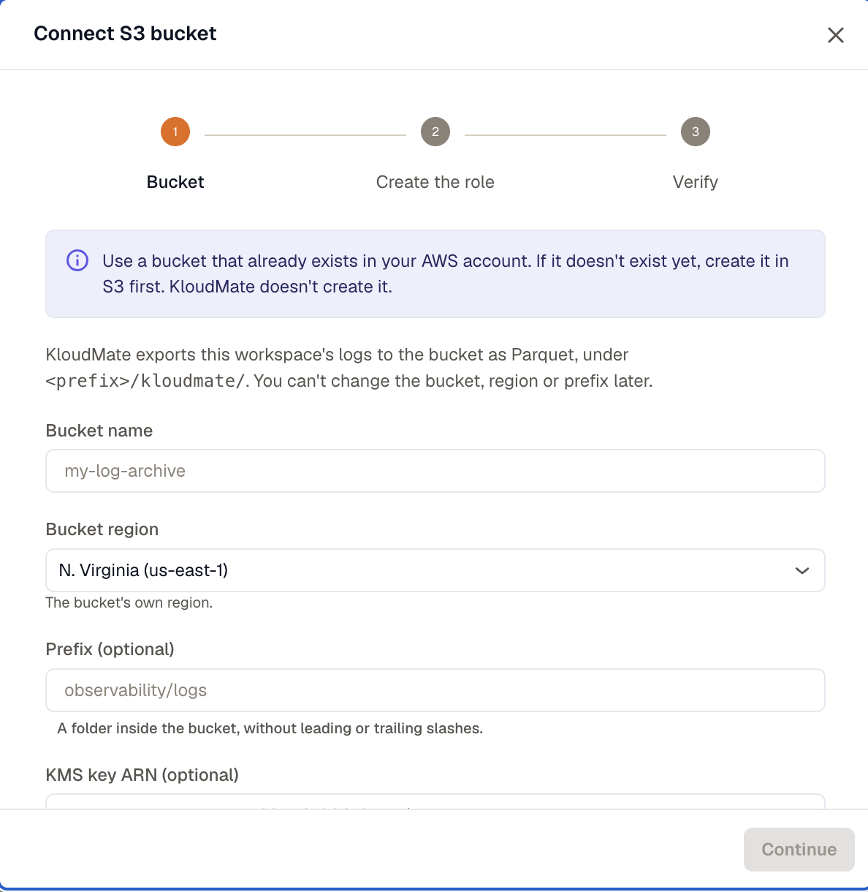
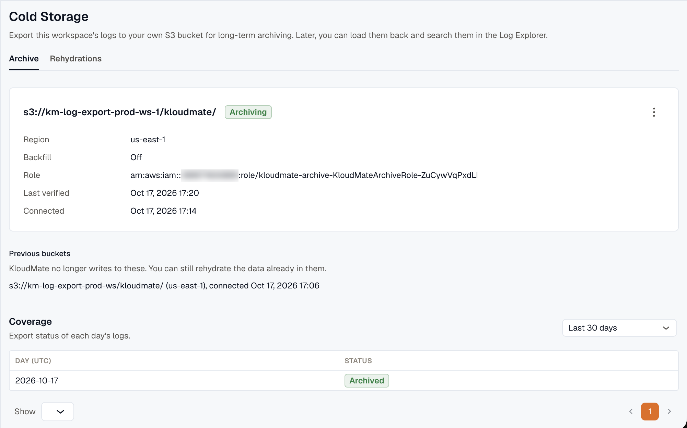
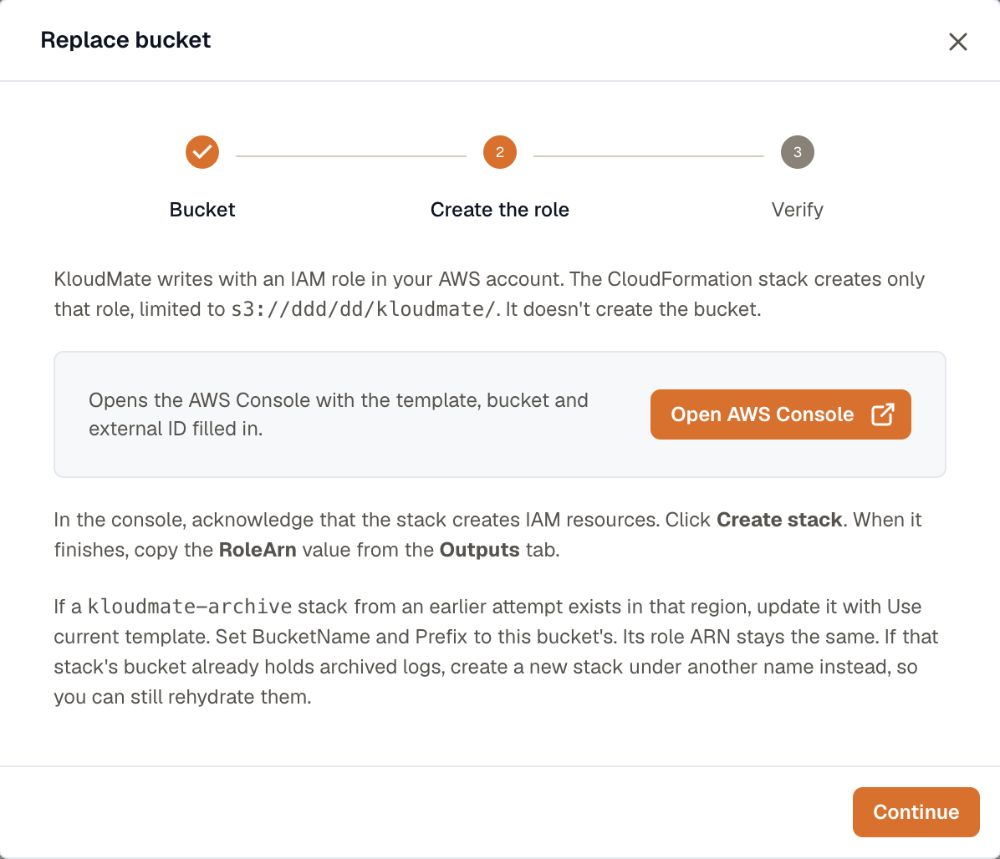

import { Steps } from '@astrojs/starlight/components';

Connect an S3 bucket in your AWS account, and KloudMate exports the workspace's logs to it every hour as Parquet files. You can then [rehydrate](../rehydrate-logs/) any archived range to search it in KloudMate, or query the files directly with your own tools. You need the organization **Owner** role to set this up.

Archiving is set up per workspace, so connect a bucket for each workspace you want to archive.

## Before you start

- **An existing S3 bucket.** KloudMate doesn't create the bucket. If you don't have one yet, create it in S3 first, and note its region: you'll need to select that exact region in KloudMate.
- **No Object Lock on the KloudMate folder.** KloudMate writes under `<prefix>/kloudmate/` and rewrites an hour's files when it re-exports that hour, so Object Lock must not apply to that folder.
- **The KMS key ARN, if the bucket uses SSE-KMS.** KloudMate writes with the bucket's default encryption. If that's SSE-KMS, have the key's ARN ready. It must be a key ARN (`arn:aws:kms:<region>:<account>:key/<key-id>`), not an alias.
- **Permission to create a CloudFormation stack that creates an IAM role.** The stack needs the `CAPABILITY_IAM` acknowledgment.
- **A log retention of at least 7 days.** KloudMate doesn't export anything for an organization whose log retention is shorter.

The bucket, region, and prefix can't be changed after you connect. To move the archive somewhere else, [replace the bucket](#replace-the-bucket).

## Connect the bucket

<Steps>

1. Open **Settings → Cold Storage** and, on the **Archive** tab, click **Connect S3 bucket**.

2. Enter the bucket details, then click **Continue**:

    - **Bucket name**: the existing bucket, for example `my-log-archive`.
    - **Bucket region**: the bucket's own region.
    - **Prefix (optional)**: a folder inside the bucket, without leading or trailing slashes, for example `observability/logs`. KloudMate writes under `<prefix>/kloudmate/`, or under `kloudmate/` at the bucket root if you leave it empty.
    - **KMS key ARN (optional)**: only if the bucket encrypts with SSE-KMS.
    - **Backfill logs already stored**: on by default. It also exports the logs already in the workspace's retention, not only new ones. Turn it off to start the archive from now.

    

3. Click **Open AWS Console**. The CloudFormation quick-create page opens in the bucket's region, with the template, bucket, prefix, KMS key, and external ID filled in. Leave **ExternalId** as it is.

    If a `kloudmate-archive` stack already exists in that region, see [If a kloudmate-archive stack already exists](#if-a-kloudmate-archive-stack-already-exists) instead.

4. In the AWS console, acknowledge that the stack creates IAM resources and click **Create stack**. When the stack finishes, copy the **RoleArn** value from its **Outputs** tab. Back in KloudMate, click **Continue**.

5. Paste the ARN into **Role ARN** and click **Verify**.

    Verify does what the export will do: it assumes the role, writes a small test file to `<prefix>/kloudmate/_verify/check.txt`, reads it back, and lists the folder. If it fails, the message tells you what to fix. See [Troubleshoot Cold Storage](../troubleshooting/).

6. When verification passes, click **Done**.

</Steps>

The first hour is exported about 2 hours after it ends. With backfill on, the older hours are exported after that, which can take a while for a workspace that stores a lot of logs. The **Coverage** table shows how far it has got.

## What the role can do

The stack creates one IAM role and nothing else. The role trusts KloudMate's AWS account, and only when the request carries your workspace ID as the external ID. Its permissions cover only `<prefix>/kloudmate/` in your bucket:

| Permission | Used to |
| --- | --- |
| `s3:PutObject` | Write the Parquet files and the verification file |
| `s3:GetObject` | Read files back for verification and rehydration |
| `s3:ListBucket`, limited to the prefix | List the folder |
| `s3:AbortMultipartUpload`, `s3:ListMultipartUploadParts` | Complete or clean up large uploads |
| `s3:RestoreObject` | Restore objects from Glacier storage classes. Rehydration doesn't use it yet. |
| `kms:GenerateDataKey`, `kms:Decrypt` | Encrypt and decrypt with your KMS key. Added only if you entered a KMS key ARN. |

The role has no delete permission, so KloudMate can't remove anything from your bucket, including files it wrote. Archived files are removed only by you or by the bucket's lifecycle rules.

## If a kloudmate-archive stack already exists

A stack name can be used only once per region, so the quick-create link fails if an earlier attempt left a `kloudmate-archive` stack there. What to do depends on whether that stack's bucket holds archived logs you still want to rehydrate:

- **It doesn't**, for example an attempt that never verified. Update the existing stack instead of creating a new one. In CloudFormation, select **kloudmate-archive**, click **Update**, choose **Use current template**, set **BucketName**, **Prefix**, and, if you use one, **KmsKeyArn** to the new bucket's values, and finish the update. The role ARN stays the same, so paste it into KloudMate and verify.
- **It does.** Keep that stack, since rehydrating from the old bucket still uses its role. On the quick-create page, change **Stack name** to something new, such as `kloudmate-archive-2`, and create the stack.

## What gets written

Each hour of logs is written to its own folder:

```text
<prefix>/kloudmate/v1/workspace=<workspace-id>/signal=logs/dt=<YYYY-MM-DD>/hour=<HH>/part-<n>.parquet
```

- Dates and hours are in UTC. A busy hour is split across several `part-<n>.parquet` files.
- The `dt=` and `hour=` folders are Hive-style partitions, so Amazon Athena, AWS Glue, and other Parquet tools can query the archive and skip the hours they don't need.
- The layout is stable. You can point Athena tables and lifecycle rules at it. New columns may be added to the files over time, but existing paths don't change.
- An hour with no logs gets no files.

### When logs are exported

- Each hour is exported about 2 hours after it ends, so logs that arrive a little late are included.
- Once a day, KloudMate checks the last 3 days and re-exports any hour whose log count has changed since it was exported. Logs that arrive more than 3 days late aren't archived.
- With backfill on, the archive also covers the logs that were already in the workspace's retention when you connected. With it off, the archive starts from the hour you connected.

## Check archive status

The **Archive** tab shows the connected bucket and its state:

- **Archiving**: verified and exporting.
- **Not working**: KloudMate can't write to the bucket. Exports are paused, and the reason is shown with its fix. See [Troubleshoot Cold Storage](../troubleshooting/).
- **Setup incomplete**: the role hasn't been verified yet. Click **Finish setup** to continue where you left off.
- **Disabled**: exports are turned off.



### Coverage

The **Coverage** table shows the export status of each UTC day for the last 30, 90, or 400 days:

- **Archived**: every hour with logs has been exported.
- **In progress**: some hours are still waiting to be exported.
- **No logs**: the day had no logs.
- **Failed**: some hours failed to export. KloudMate retries them once a day while they're still within the workspace's retention.
- **Expired**: some hours left retention before they could be exported. They aren't in the archive.

A day shows its worst status, so one failed hour marks the whole day as **Failed**.

## Manage the bucket

**Replace…**, **Disable**, and **Delete** are in the bucket's **More options** menu.

### Verify or change the role

When the bucket shows **Not working**, fix the cause in AWS and click **Verify**. Exports resume when it passes. Click **Change role** to use a different role ARN.

### Replace the bucket

Click **Replace…** to connect a different bucket, region, or prefix. It's available while exports are enabled. You go through the same steps as a new connection. New hours are exported to the new bucket, and the old one moves to **Previous buckets**.



You can still rehydrate logs from a previous bucket as long as its role keeps working, so leave the old stack as it is. If the new stack goes in the same region, give it a new name, as described in [If a kloudmate-archive stack already exists](#if-a-kloudmate-archive-stack-already-exists).

### Disable or enable exports

Click **Disable** to stop exports. When you click **Enable** again, KloudMate exports the hours it missed, as long as they're still within the workspace's retention. You can still rehydrate the logs already archived while exports are disabled.

### Delete the archive

Click **Delete** to stop archiving the workspace and remove the bucket connection. KloudMate also deletes its record of every hour it exported, to this bucket and to any previous ones, and without that record those logs can't be rehydrated. Rehydrations that are still loading are cancelled. Ready ones stay searchable until they expire.

The files stay in your bucket, because KloudMate has no permission to delete them. You can still query them with your own tools. To remove the role too, delete the CloudFormation stack in AWS.
