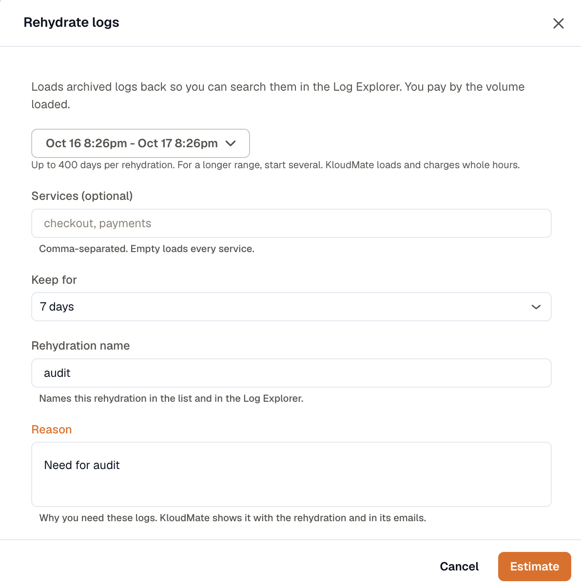
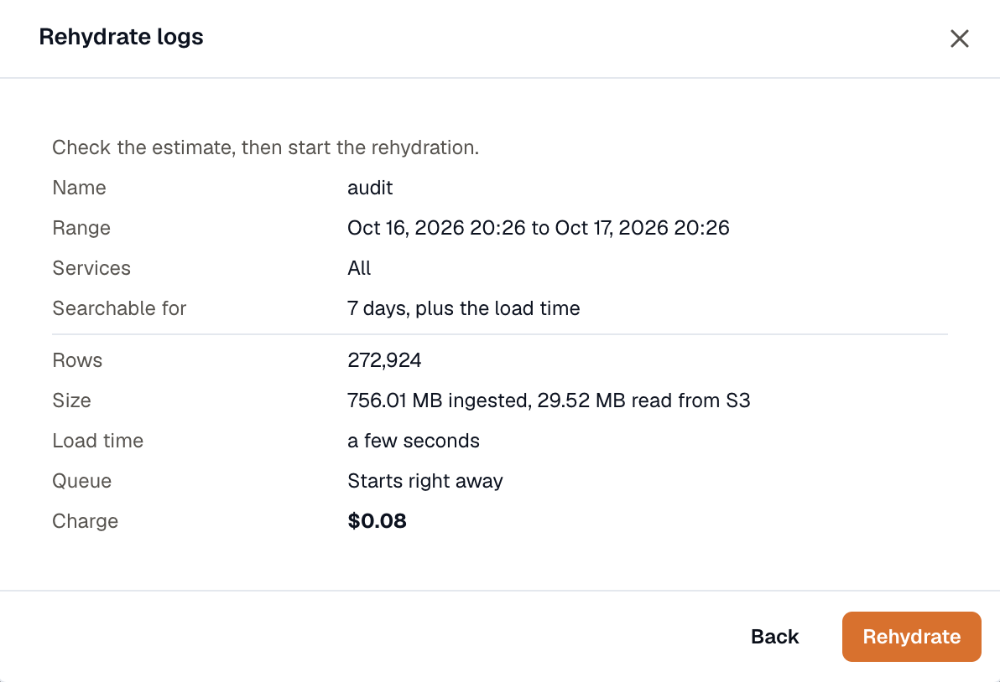
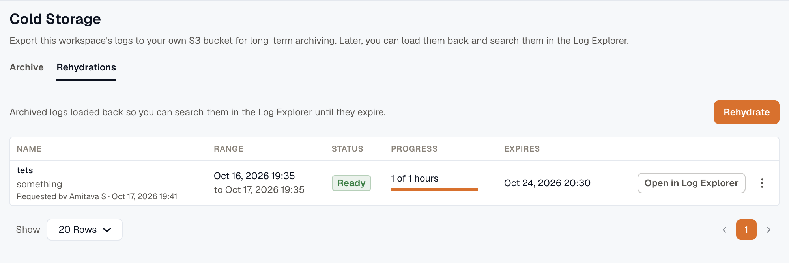
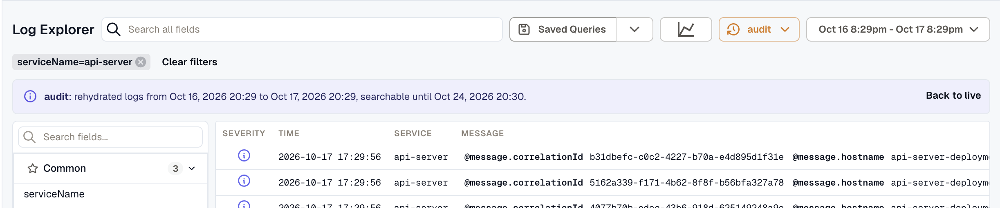

import { Steps } from '@astrojs/starlight/components';

Rehydration loads a time range from your S3 archive back into KloudMate, so you can search logs that are older than your retention in the Log Explorer. A rehydration stays searchable for 7 or 14 days, then KloudMate removes it.

You need the **Owner** or **Developer** role to start, cancel, or delete a rehydration. Everyone in the workspace, including Viewers, can see rehydrations and search them.

Only hours that have already been [archived](../archive-logs-to-s3/) can be loaded. The **Coverage** table on the **Archive** tab shows which days are in the archive.

## Start a rehydration

You can start one from either place:

- **Settings → Cold Storage → Rehydrations**: click **Rehydrate**.
- **Log Explorer**: when the selected time range starts before your log retention, a notice offers **Rehydrate**, and the **Live logs** menu shows **Rehydrate this range…**. Both fill in the time range you're looking at.

<Steps>

1. Set the **Range**. One rehydration can cover up to 400 days. For a longer period, start several. KloudMate loads and charges whole UTC hours, so a range that starts at 10:30 includes the whole 10:00 hour.

2. Optionally, enter **Services** as a comma-separated list, for example `checkout, payments`. Leave it empty to load every service.

3. Choose how long to **Keep for**: **7 days** or **14 days**.

4. Enter a **Rehydration name**, for example `Checkout errors, 12 Oct`. It identifies the rehydration in the list and in the Log Explorer.

5. Enter a **Reason** that says why you need these logs. It's required, and it's shown with the rehydration and in its emails.

    

6. Click **Estimate**. Check the estimate, then click **Rehydrate** to start.

</Steps>

The estimate shows the rows and size that will load, how long loading will take, when it will start, how long it stays searchable, and the **Charge**. **Size** shows both the volume originally ingested, which the charge is based on, and the amount read from S3.

Filtering by service narrows what you load and search, but it doesn't reduce the estimate or the charge. Both cover every service in each hour, because the archive is read an hour at a time.

## Limits

The estimate checks these limits and tells you which one a request breaks:

- **Range**: at most 400 days per rehydration.
- **Size**: at most 1,000 GB of ingested logs per rehydration. Split a larger range into several rehydrations.
- **Active rehydrations**: at most 2 per organization, across all its workspaces. A rehydration counts while it's queued, loading, or paused, and after it's ready until it expires or you delete it.
- **Overlap**: a new rehydration can't overlap the range of an active one in the same workspace.
- **Archived hours**: if nothing in the range has been exported yet, there's nothing to load.
- **Capacity**: if KloudMate can't load the range right now, try a shorter range or try again later.

## How long it takes

Rehydration isn't instant. The estimate's **Load time** and **Queue** rows show roughly how long it will take and when it will start. Treat them as a guide, since the actual time can be longer.

You can search a rehydration as soon as its first hour has loaded. While it's still loading, the Log Explorer shows how many hours have loaded so far.

When a rehydration is ready, or if it fails, KloudMate emails the person who requested it and the organization's Owners.

## Rehydration status

The **Rehydrations** tab lists every rehydration in the workspace, newest first, with its status:

| Status | What it means |
| --- | --- |
| **Queued** | Waiting for its turn. The **Progress** column shows how many are ahead. |
| **Loading** | Loading hour by hour. Searchable once the first hour has loaded. |
| **Paused** | Waiting for capacity to load the rest. It resumes on its own, and the hours already loaded stay searchable. |
| **Ready** | Finished, and searchable until it expires. If some hours failed to load, **Progress** shows how many. Hover over the count to see why. |
| **Failed** | No hour could be loaded. Hover over the status to see why. |
| **Cancelled** | Stopped before it finished. It's no longer searchable. |
| **Expired** | Past its keep-for period. It's no longer searchable. |

## Search a rehydration in the Log Explorer

<Steps>

1. Open the rehydration in either of these ways:

    - On the **Rehydrations** tab, click **Open in Log Explorer**.
    - In the Log Explorer, click **Live logs** and select the rehydration under **Rehydrated**.

2. Search and filter as you would with live logs. The time range is set to the rehydration's range, and a banner shows the range and when it expires. Only logs from this rehydration are searched.

3. Click **Back to live** when you're done.

</Steps>

Rehydrated logs are searchable only in the Log Explorer. Dashboards, alerts, and other parts of KloudMate keep reading live data. Streaming and **Jump to Now** aren't available while you're reading a rehydration, since it covers a fixed range in the past.

## Expiry

The keep-for period is counted from when loading starts plus the estimated load time, that is, from about when loading finishes. The **Expires** column shows the exact time. After that, the rehydration shows **Expired**, and its logs are removed from KloudMate.

Expiry doesn't touch the files in your bucket. To search the same range again, start a new rehydration. It's charged again.

## Cancel or delete a rehydration

Open the rehydration's **More options** menu on the **Rehydrations** tab:

- **Cancel** stops a rehydration that's queued, loading, or paused. The logs loaded so far are no longer searchable.
- **Delete** removes a rehydration and its logs from KloudMate right away. Deleting a ready rehydration frees its place in the organization's limit of 2 active rehydrations.

Either way, the hours that already loaded are still charged.

## Pricing

Rehydration costs $0.10 per GB, measured on the volume the workspace originally ingested for each hour that loads. Each hour is charged as it loads, so hours that fail to load aren't charged. The charge appears on your KloudMate bill as **Log Rehydration**.

AWS bills your account separately for the data read out of S3. That cost isn't part of the estimate's **Charge**, but the estimate shows the size read from S3, so you can work it out from AWS's data transfer pricing.

## Logs in Glacier storage classes

Rehydration reads the archived files directly from your bucket. It can't read files that a lifecycle rule has moved to S3 Glacier Flexible Retrieval or S3 Glacier Deep Archive, or to the Archive Access or Deep Archive Access tier of S3 Intelligent-Tiering. Files in S3 Standard, Glacier Instant Retrieval, and the other storage classes load directly.

The estimate doesn't check storage classes, so it still counts those hours in its rows and charge. When loading reaches one of them, that hour fails right away with a reason saying its files are in a Glacier storage class. You aren't charged for it, and the rest of the range keeps loading.

To search those hours, restore their files in S3, then rehydrate the range again. A new rehydration can't overlap an active one in the same workspace, so delete the first rehydration or wait for it to expire.

:::tip
If you might want to rehydrate logs later, keep them in S3 Standard or Glacier Instant Retrieval. Glacier Instant Retrieval costs less to store and loads without a restore.
:::
